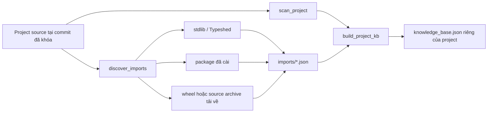

# Luồng process data hiện tại

Luồng chính tạo dữ liệu generative: model nhận code đã mask và các type gợi ý,
rồi sinh annotation Python. Điểm vào là `python -m typepro process-data`
(`typepro/data/prepare.py`), với các stage `metadata`, `slice`, `finalize`, hoặc
`all`. Notebook Kaggle chạy riêng từng stage để phân phối công việc và merge.

## 1. Chuẩn bị metadata

`prepare.py` tải TypeGen `data.zip` (hoặc dùng `--archive` local), kiểm tra SHA256,
đọc `trainset.json`, `testset.json`, `testset_randomsampled.json`.

Nó lọc annotation theo scope và cấu hình, loại mẫu thiếu ground truth, tạo
metadata cùng split manifest. Notebook hiện bật `--include-builtins` và
`--include-returns`, nên giữ cả type built-in, parameter và return. Mặc định CLI
chỉ giữ parameter và loại built-in; cần truyền hai cờ này để khớp notebook.

Với profile `paper_project`, metadata gộp và deduplicate train/test rồi chia theo
project bằng hash ổn định. Đây là phân chia ban đầu; finalizer hiện tại sẽ chọn
lại test holdout từ các project có mẫu dùng được.

## 2. Chọn project, revision và job

`configs/project_revision_lock.json` khóa commit của từng project.
`build_project_revision_lock.py` là công cụ tạo/cập nhật lock, không chạy lại
trong mỗi job. Notebook dùng policy `only`: chỉ xử lý project có trong lock.
Commit source TypePro do scheduler pin là revision riêng với commit project.

`slice_projects()` phân project bằng hash và tọa độ shard. Workflow Kaggle hiện
có 10 logical shards, được chia thành 21 physical jobs trên ba account theo
`shard_account_plan.json`; `shard_merge_plan.json` liệt kê chính xác inputs.
Một số partition có mẫu số 20, 30, 40 hoặc 90; không thay bằng 21 phần bằng nhau.
Scheduler giới hạn tối đa năm job đang hoạt động trên mỗi account.

## 3. Clone và xây knowledge base cho từng project

Mỗi project được clone/checkout đúng revision đã khóa. Builder phân tích imports,
có thể tải wheel để lấy định nghĩa thư viện, rồi gọi `analysis/project_kb.py`
tạo `project_kb/<owner>__<repo>/knowledge_base.json`.

KB được cô lập theo project và tái sử dụng cho mọi annotation trong project đó.
Quá trình tạo KB có hai nguồn đầu vào:



### 3.1. Quét dependencies

Trong `prepare.slice_projects()`, command đầu tiên của pha KB chạy
`analysis/build_third_party_kb.py`. `discover_imports()` parse mọi file `.py` và
`.pyi` của project, lấy tên package gốc từ `import x` và `from x.y import z`, rồi
loại các module thuộc chính project.

Với mỗi package còn lại, builder ghép source từ các nguồn sau:

1. Package Python đã cài trong môi trường.
2. Nếu package chưa có và `--download-missing-imports` đang bật, chạy
   `pip download --no-deps`, giải nén wheel/source archive vào cache tạm.
3. Stub trong Typeshed nếu có. Với standard library, khi đã có stub thì source
   runtime được bỏ qua; với package khác, record stub ghi đè record runtime trùng
   `(type, name, module)` vì stub mô tả public API rõ hơn.

`scan_package()` parse source package và tạo record cho:

- class: tên đầy đủ, base classes, public fields và method signatures;
- type alias: alias tường minh và một số alias typing có thể chứng minh;
- function public: signature để lập inventory API.

Ví dụ source thư viện:

```python
class Session:
    timeout: float

    def request(self, url: str) -> Response:
        ...
```

được rút thành record gần giống:

```json
{
  "kind": "class",
  "name": "Session",
  "qualified_name": "package.client.Session",
  "source": "third_party",
  "fields": ["timeout: float"],
  "methods": ["def request(self, url: str) -> Response:"],
  "definition": "class Session:\n    # package: package\n    ..."
}
```

Các record được ghi tạm theo package vào thư mục `imports` của project. File
này là nguyên liệu cho project KB; nó không được truy vấn như một catalog global.
Nhờ vậy hai project import hai tập package hoặc version khác nhau không dùng lẫn
KB.

### 3.2. Quét source nội bộ và hợp nhất project KB

Sau đó `prepare.py` chạy `analysis/project_kb.py`. Hàm
`build_project_kb(project_root, imports_dir)` gọi `scan_project()` để parse source
thành các tuple `(path, module, source, AST)`, rồi duyệt các declaration tĩnh.

Project KB chứa các loại record chính:

| `kind` | Nguồn | Nội dung dùng cho retrieval |
| --- | --- | --- |
| `class` | Class trong project hoặc dependency | Qualified name, bases, fields, methods và definition |
| `type_alias` | `TypeAlias`, `NewType` và alias typing đã xác minh | Tên alias, target và declaration |
| `reexport_alias` | `from a import X as Y` | Alias mới và symbol gốc |
| `function_return` | Constructor nhìn thấy trong thân hàm | Type được suy ra từ `return User()` |
| `alias` / `imported_symbol` | Dependency record | Type/API đã copy vào KB riêng của project |

`add_record()` deduplicate bằng cặp `(kind, qualified_name)`. Sau khi thu thập,
`resolve_inherited_members()` nối member của base class khi base resolve duy nhất.
Điều này giúp candidate con vẫn khớp khi code gọi method kế thừa.

Một điểm chống leakage quan trọng nằm ngay trong `build_project_kb()`:

```python
stored_class = copy.deepcopy(node)
for method in ast.walk(stored_class):
    if isinstance(method, (ast.FunctionDef, ast.AsyncFunctionDef)):
        method.returns = None
```

Với function cấp module, code cũng tạo bản sao rồi đặt:

```python
signature_node.returns = None
```

Vì return annotation có thể là nhãn của một sample, nó không được phép tạo
candidate, điểm ranking hoặc signature trong shared KB. Bằng chứng executable
vẫn được giữ: `return User()` có thể sinh record `function_return=User`, còn
`def load() -> User` tự nó không được dùng làm bằng chứng.

Definition đầy đủ của class được lưu một lần trong KB để về sau có thể chọn đúng
member liên quan. Nó chưa bị cắt theo ngân sách prompt ở bước này. Output có dạng:

```json
{
  "schema_version": "typepro-project-kb-v7-source-evidence",
  "project": "repo",
  "parse_failures": 0,
  "record_count": 123,
  "records": [ ... ]
}
```

### 3.3. Vì sao KB dùng chung vẫn không lộ target

KB được xây một lần, nhưng target thay đổi theo từng annotation. Vì vậy pipeline
không sửa KB gốc. Khi xử lý một sample, `export_one()` tạo bản source đã mask và
`top_project_types()` gọi `mask_definition()` trên bản sao definition trước khi
chấm điểm hoặc trả candidate.

Ví dụ KB có:

```python
class Repository:
    def load(self, key: str) -> User:
        ...
```

Khi target là return của `Repository.load`, bản dùng cho sample trở thành:

```python
class Repository:
    def load(self, key: str) -> <mask>:
        ...
```

KB JSON ban đầu không đổi. Sample khác vẫn có thể lấy một bản sao với target
khác được mask. Test `tests/test_target_masking.py` thay duy nhất ground truth
giữa hai lần export và yêu cầu slice/candidates giữ nguyên, nhằm phát hiện đường
rò nhãn.

## 4. Mask, slice và lấy type gợi ý

`analysis/export_slices.py` xử lý từng annotation: xác định target, mask type cần
dự đoán trước retrieval, tạo context/slice qua AST và dependency, giữ bằng chứng
từ caller/callee khi resolve được, rồi lấy tối đa 10 type từ project KB.
Candidate có definition, score và ngân sách ký tự theo `candidate_policy.py`.
Ground truth không được chèn vào candidate để làm positive.

### 4.1. Xác định và mask target

Mỗi metadata row có `file`, `loc`, `scope`, `name` và `gttype`. `export_one()`
parse target file, `find_target_function()` dùng location/tên hàm để tìm đúng AST
node, rồi chọn annotation theo scope:

- `arg`: annotation của parameter có tên bằng `row["name"]`;
- `return`: `FunctionDef.returns`;
- scope biến: annotation của assignment tương ứng.

`mask_annotation(source, annotation)` thay đúng span annotation bằng sentinel
hợp lệ về cú pháp. Trong output, sentinel được render thành `<mask>`:

```python
def send(client: Client, request: Request) -> Response:
    return client.send(request)
```

nếu target là parameter `client` sẽ thành:

```python
def send(client: <mask>, request: Request) -> Response:
    return client.send(request)
```

`source_overlay()` cho các analyzer đọc view đã mask trong một context manager,
sau đó luôn khôi phục source gốc, kể cả khi có exception. `Function_methods` và
catalog được copy hoặc tái sử dụng, nhưng mọi signature/definition có thể chứa
target đều đi qua `mask_definition()` trước khi AST binder hoặc reducer đọc nó.

### 4.2. Tạo interprocedural slice

`_export_masked_one()` tạo `Slicer` rồi chọn một trong ba đường:

```python
if scope == "arg":
    code_slice = slicer.slicing_params(...)
elif scope == "return":
    code_slice = slicer.slicing_func(...)
else:
    code_slice = slicer.slicing_var(...)
```

Slice không đơn giản là toàn bộ function. Các reducer trong
`ast_context_slicer.py` giữ những statement có quan hệ dữ liệu/hành vi với target:

- assignment và alias truyền giá trị của target;
- truy cập attribute, subscript, method call và operation trên target;
- control condition, loop input/update và control transfer cần cho statement đã
  giữ;
- docstring đầu function;
- return path khi đang dự đoán return type;
- import và alias đã resolve cần để hiểu symbol.

Ví dụ:

```python
def send(client: Client, request: Request) -> Response:
    debug = expensive_debug_dump()       # không liên quan
    session = client.session
    payload = request.to_payload()
    result = session.post(payload)
    log_debug(debug)                     # không liên quan
    return result
```

Khi target là `client`, slice có thể giữ signature đã mask, `client.session`,
phép truyền dữ liệu tới `session.post(...)` và các declaration/call context đã
resolve; các dòng chỉ phục vụ `debug` có thể bị bỏ.

`reduced_target()` còn mở rộng context có kiểm soát:

- callee: resolve đúng qualified function, bind arguments, rồi giữ signature
  hoặc phần body cần thiết; chỉ mở rộng một hop;
- caller: `function_use_data()` tìm call site đã resolve và giữ expression truyền
  argument cùng dependency của nó;
- nếu resolution mơ hồ, receiver không rõ hoặc name bị shadow, code không chèn
  một body đoán mò. Nó giữ signature/contract có thể chứng minh hoặc ghi
  diagnostic `unresolved`/`omitted`.

Với target parameter, `slicing_params()` ghép imports, header class bao ngoài,
target body đã reduce, related callee context và caller context. Với return,
`slicing_func()` dùng `collect_func_slicing(..., returns=True)` để giữ dependency
dẫn tới return cùng caller context. Với assignment, `slicing_var()` lần ngược
statement tạo và sử dụng biến.

Mỗi quyết định reduce/resolve được ghi trong
`recommendation_diagnostics.context_reduction`; timing và số kết quả của từng
nguồn retrieval cũng được ghi để audit.

### 4.3. Tạo tập ứng viên ban đầu

Trong lúc tạo slice, `Slicer.add_high_recall_recommendations()` thu các tín hiệu
recall cao từ source đã mask:

- exact imports nhìn thấy trong slice;
- class/type alias xuất hiện trực tiếp trong slice;
- type signals từ cách biến được sử dụng;
- exact import và semantic match trong project index;
- inventory của module import;
- name similarity và BM25 như fallback.

Các giá trị này trở thành `seed_recommendations`. Trong workflow hiện tại luôn
có project KB, `top_project_types()` giữ tham số seed để tương thích nhưng không
dùng seed làm candidate hay cộng điểm; universe để chọn candidate là
`candidate_records(project_kb)`. Seed chỉ trở thành fallback records nếu gọi
exporter không kèm project KB. Chỉ các record có `kind` phù hợp như
class/alias/function_return/imported symbol mới được xét; function thường không
tự trở thành một type candidate.

### 4.4. Thu bằng chứng trực tiếp mà không đọc annotation

`candidate_policy.source_evidence()` tạo hai tập bằng chứng:

- `import`: qualified symbol đến từ một import tường minh, không shadow và resolve
  duy nhất trong scope;
- `direct`: constructor có thể chứng minh từ source executable.

Với return target, ví dụ `return User()` tạo direct evidence cho `User`. Với
parameter target, caller `save(User())` có thể tạo direct evidence sau khi
`bind_arguments()` chứng minh expression đó được truyền đúng parameter. Code có
thể lần theo một zero-argument factory đã resolve, nhưng không bao giờ dùng return
annotation của factory. Binding mơ hồ, dynamic branch, local import không chắc
chắn và receiver không rõ sẽ không nhận điểm direct/import.

### 4.5. Chấm điểm candidates

`top_project_types()` mask definition theo target hiện tại rồi gọi
`score_candidate()`. Chính sách hiện tại là `candidate-weighted-v1`:

```text
score = 5.0 × direct
      + 3.0 × usage
      + 2.0 × bm25
      + 1.0 × name
      + 0.5 × import
```

Trong đó:

| Thành phần | Ý nghĩa | Miền giá trị |
| --- | --- | --- |
| `direct` | Constructor/type được chứng minh từ return hoặc caller argument | 0 hoặc 1 |
| `usage` | Tỷ lệ method/attribute mà target dùng và candidate cung cấp | 0..1 |
| `bm25` | Độ giống cấu trúc giữa slice và definition | 0..1 theo scorer |
| `name` | Độ giống tên target và tên candidate | 0..1 |
| `import` | Candidate được import tường minh và resolve chắc chắn | 0 hoặc 1 |

`target_member_query()` thu method/attribute qua target và alias chắc chắn. Nếu
slice có `client.send()` và `client.timeout`, candidate cung cấp cả hai nhận
`usage=1.0`. Name similarity chỉ có trọng số 1 nên không đủ lấn át bằng chứng
constructor trực tiếp có trọng số 5.

Candidate có score dưới `MIN_SCORE=1.0` bị loại. Phần còn lại được sort theo
score giảm dần, rồi theo `qualified_name` để kết quả ổn định; deduplicate bằng
qualified name và lấy tối đa `MAX_CANDIDATES=10`. Ground truth `gttype` không
được truyền vào bất kỳ hàm scoring nào.

### 4.6. Rút definition và chia ngân sách prompt

Trước khi ghi candidate, class definition được rút theo member target thực sự
dùng bằng `reduce_class()`. Nếu class lớn, `limit_candidate_definition()` ưu tiên:

1. declaration/signature hoàn chỉnh;
2. docstring theo paragraph hoàn chỉnh;
3. whole method body nếu còn chỗ;
4. bỏ cả declaration ở cuối thay vì cắt code giữa dòng.

`allocate_characters()` áp dụng các giới hạn hiện tại:

- tối đa 10 candidates;
- tổng section `[RECOMMENDATION_TYPES]` tối đa 16.000 ký tự;
- mỗi definition tối đa 4.000 ký tự;
- trước tiên dành một summary khoảng 600 ký tự/candidate;
- phần dung lượng còn lại chia theo score bằng weighted water-filling.

Candidate có header/definition không thể tạo thành declaration hợp lệ sẽ bị bỏ
và candidate xếp sau được xét tiếp. Output mỗi candidate lưu `score`,
`score_components`, `definition_reduction`, `context_reduction` và
`character_budget`, nên có thể giải thích tại sao nó được chọn và bị rút gọn ra
sao.

### 4.7. Raw slice được ghi ra

Một row sau export có cấu trúc rút gọn như sau:

```json
{
  "name": "client",
  "scope": "arg",
  "gttype": "Client",
  "target_function": "send",
  "interprocedural_slice": "def send(client: <mask>, ...): ...",
  "recommendation_types": [
    {
      "name": "Client",
      "qualified_name": "pkg.Client",
      "source": "third_party",
      "kind": "class",
      "definition": "class Client: ...",
      "score": 9.2,
      "score_components": {
        "direct": 1.0,
        "usage": 0.5,
        "bm25": 0.6,
        "name": 1.0,
        "import": 1.0
      }
    }
  ],
  "candidate_policy_version": "candidate-weighted-v1",
  "context_policy_version": "ast-context-v7-verified-signature-evidence",
  "target_masking_version": "typepro-shared-kb-masked-source-v7-resolved-bounded-context"
}
```

Các con số trên chỉ minh họa hình dạng dữ liệu; score thật được tính từ từng
sample. Candidate đúng có thể vắng mặt nếu source/KB không cung cấp đủ bằng
chứng. Pipeline không chèn `gttype` vào danh sách để làm đẹp coverage.

Kết quả ghi vào `raw_slices/*.jsonl`, kèm `source_commit`, policy và thông tin
target. `project_status/` lưu trạng thái, lỗi, timeout và thống kê export;
`runtime_manifest.json` ghi cấu hình/schema. Resume chỉ tái dùng kết quả tương
thích revision và policy. Clone tạm được dọn theo cấu hình.

## 5. Publish shard rồi merge

`publishing/shard.py` kiểm tra và đóng gói metadata, raw slices, project status,
project KB và manifests. Các job publish Dataset của partition theo owner và
visibility trong plan. Submit kernel chưa chứng minh Dataset đã hoàn tất.

Notebook merge kiểm tra đủ 21 inputs/manifest trước khi gọi `data/merge.py`.
Merge đối chiếu metadata, revision lock, schema/policy; từ chối legacy rows,
definition vượt giới hạn và file trùng đường dẫn có nội dung khác nhau.
Đây là merge dữ liệu trung gian, chưa phải nối các tập train đã preprocess.

## 6. Chọn holdout và preprocess generative

Finalizer gọi `data/split.py`, ưu tiên project dùng được trong
`configs/test_projects.txt`, bổ sung ổn định từ project khác để đủ **100 project
test**. Không đủ project thì báo lỗi. Các project còn lại được chia
train/validation với validation ratio 0,10 theo hash; đây là tỷ lệ project,
không bảo đảm đúng 10% số mẫu. Map cuối được lưu trong `project_split_map.json`.

`data/preprocess.py` đọc raw slices, chuẩn hóa `gttype` qua
`shared/type_labels.py`, loại mẫu thiếu target name/label/slice hoặc label không
hợp lệ, chuẩn hóa và giới hạn candidates. Mẫu không có recommendation vẫn được
giữ nếu các trường bắt buộc hợp lệ.

Mỗi dòng đầu ra có `input` gồm `[TARGET_NAME]`, `[TARGET_FUNCTION]`,
`[TARGET_SCOPE]`, `[INTERPROCEDURAL_SLICE]`, `[RECOMMENDATION_TYPES]`; `label` là
annotation đã chuẩn hóa. Dòng còn giữ project, split, source commit, slice,
candidates và policy để kiểm tra. Không có positive/negative contrastive.

Output gồm `train.jsonl`, `validation.jsonl`, `test.jsonl`, thống kê preprocess,
project split map, audit test, project KBs, `manifest.json` và Dataset card.
Manifest ghi số dòng, SHA256 và provenance. Finalize tiêu thụ raw slices và di
chuyển KB sang output, dọn dữ liệu trung gian để tiết kiệm dung lượng.

## 7. Verify và publish final

`data/verify.py` đối chiếu schema, số dòng, hash, trường/tag bắt buộc, giới hạn
candidate, liên kết KB khi KB hiện diện, và tính độc lập/đủ coverage của fixed
project holdout. `publishing/final.py` đóng gói, kiểm tra và publish private
Dataset `duyvu1105/typepro-python-generative`.

Publisher xử lý tên project đụng nhau khi không phân biệt hoa/thường và tạo
`project_kb_index.json` để ánh xạ đường dẫn KB. Phải xác nhận version/file listing
đã xuất bản; trạng thái ready của version cũ không chứng minh version mới thành công.
Train/inference đọc Dataset đã hoàn tất, không xây lại dataset trong lúc train.
