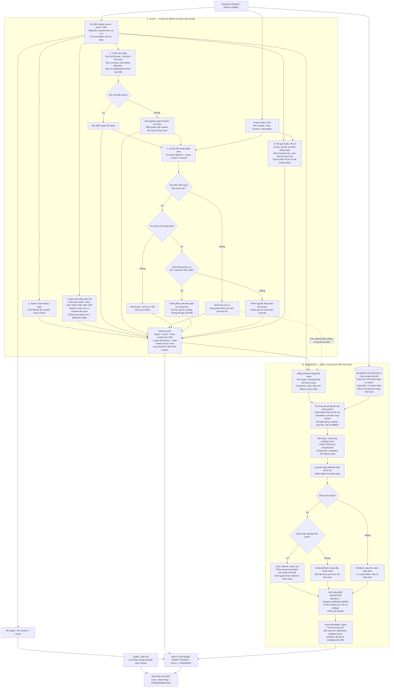

# Luồng dự kiến sửa: lấy gì vào slice, lấy gì vào candidate?

**Sơ đồ chỉ mô tả phương án dự kiến sau sửa theo [plan](ke_hoach_sua_phinh_input_20261010.md). Chưa triển khai code.**

## Cách đọc

| Phần | Những gì được lấy |
| --- | --- |
| **Slice: target** | Chữ ký đã mask và các câu lệnh phục vụ suy luận kiểu; không cắt chắc thì giữ target function |
| **Slice: ngữ cảnh tên/class** | Import, alias, class header, thuộc tính/member thực sự cần để hiểu context; không lấy class đoán theo tên |
| **Slice: hàm được gọi** | Chỉ code của callee đã resolve đúng; bind/cắt không chắc thì giữ nguyên đúng hàm đó |
| **Slice: nơi gọi target** | Đối số và code tạo ra chúng từ call site đã xác định đúng target; không gom nơi gọi chỉ vì trùng tên |
| **Candidate: nguồn** | Class project, class thư viện trong KB project, type alias, re-export alias, kiểu suy từ constructor trong thân hàm; không lấy kiểu từ return annotation |
| **Candidate: giới hạn** | Tối đa 10; mỗi `definition` lấy tối đa 16.000 ký tự **sau chọn member/masking**, kể cả fallback |
| **KB** | Class project vẫn đầy đủ để các mẫu khác chọn member; không ghi definition đã cắt ngược vào KB |

Các nguồn trên là những phần **có thể được lấy khi có bằng chứng và đúng scope**; không phải mẫu nào cũng chứa đủ mọi phần. Nhánh biến global áp dụng khi scope đó được cấu hình export. Callee chỉ mở rộng một hop; không quét đệ quy mọi lời gọi trong thân callee vừa thêm.

**Ba ranh giới cần giữ:**

- Các hàm khớp tên là ứng viên tra cứu nội bộ, không tự thành thân hàm trong slice hoặc danh sách recommendation. Function signature có thể nằm trong index/KB để tra cứu nhưng không tự là candidate kiểu.
- Nếu target chính là receiver chưa biết kiểu, không dùng một class candidate như kiểu đã biết để resolve method của nó. Candidate có thể dùng cùng bằng chứng member mà vẫn chỉ là giả thuyết.
- Trần 16.000 chỉ dành cho từng candidate definition; không tính tên/tag và không áp lên KB hoặc slice. Cắt chuỗi có thể dừng giữa method; tối đa 10 definition vẫn có thể dài tổng cộng 160.000 ký tự. Không coi đó là số token hay bảo đảm vừa context model.

`other_prompt` và diagnostics có thể lưu ở raw output để kiểm tra nhưng không phải section của input generative đang đề xuất. Độ dài, lý do fallback và provenance được lưu riêng; preprocess kiểm tra lại trần definition trước khi ghép input.
